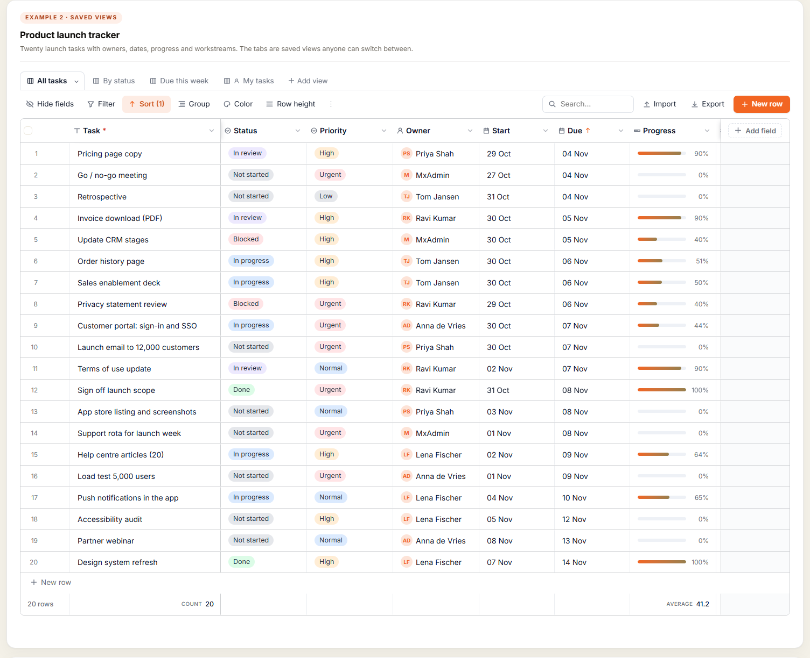
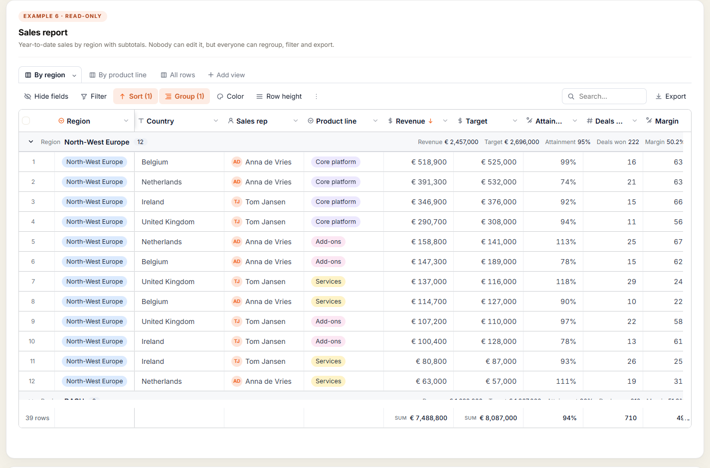
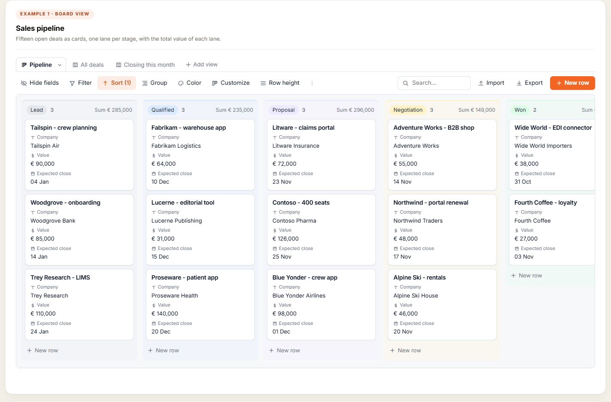
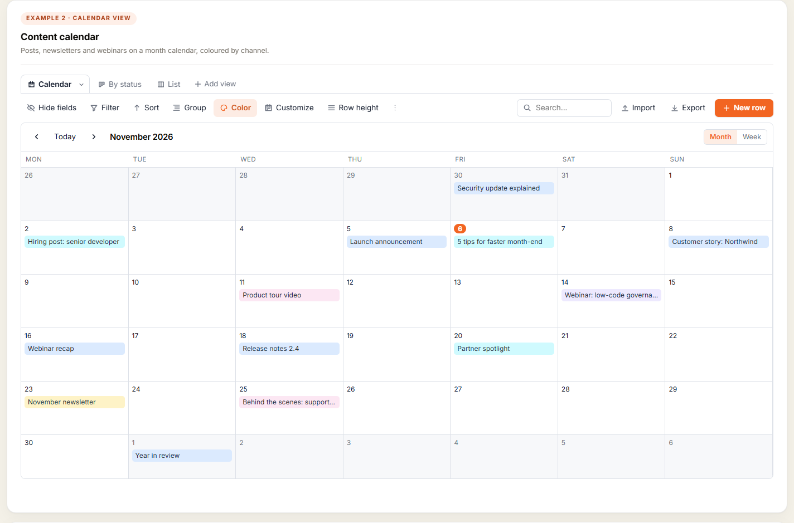
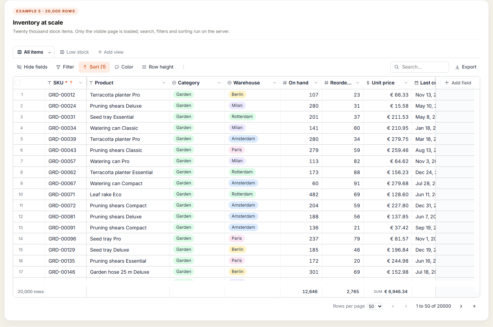
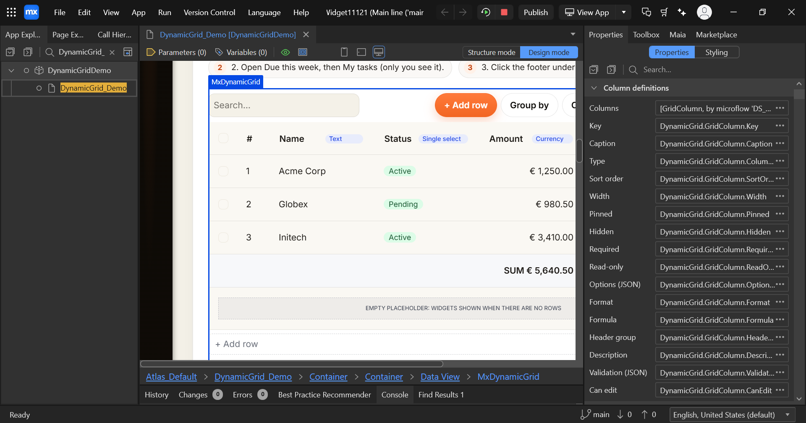
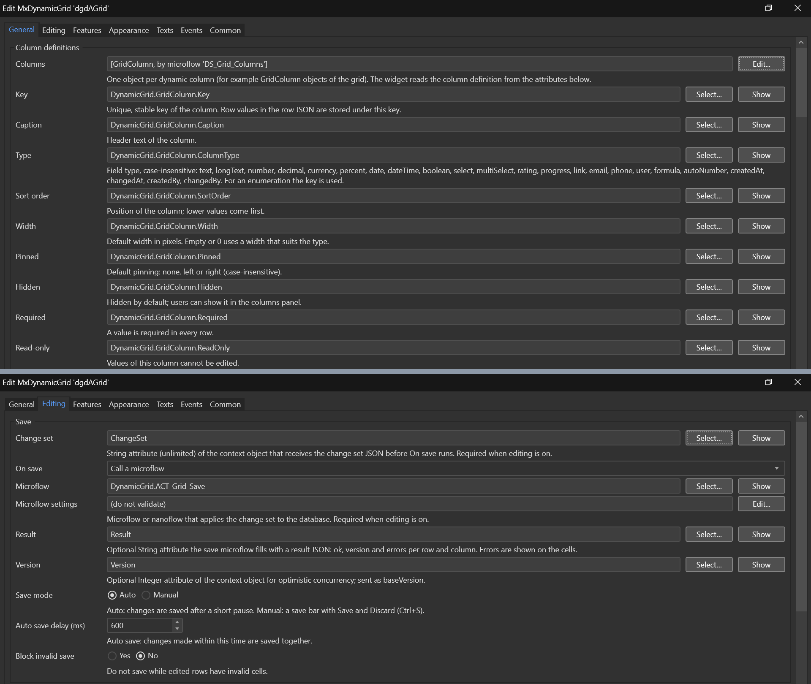
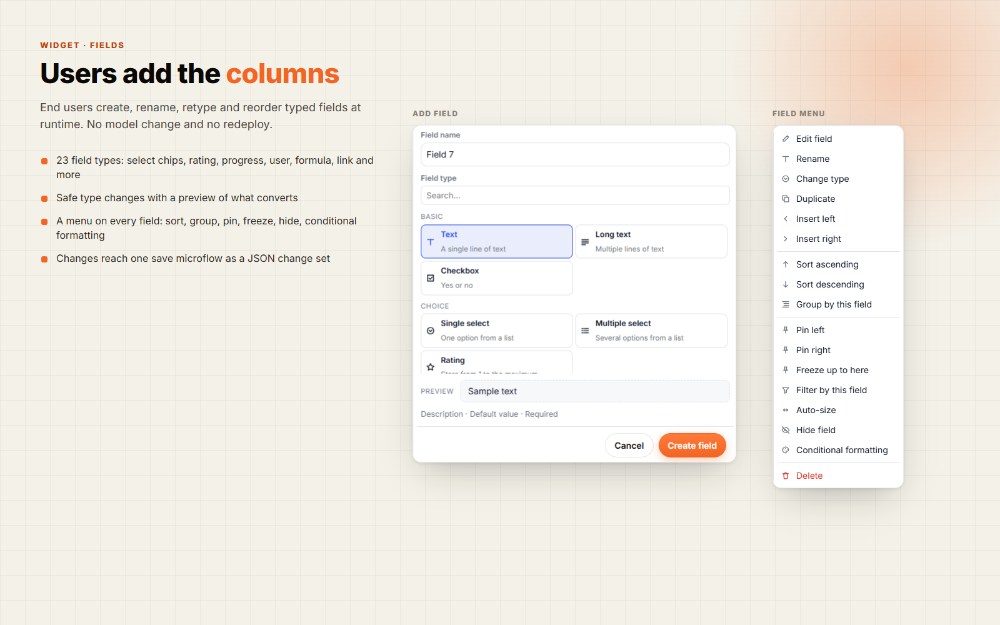

# MxDynamicGrid

> A Mendix data grid whose columns are data. End users add, rename, retype, reorder, pin, hide and delete typed
> fields at runtime, Airtable style, then edit rows, switch between saved views, boards and calendars, and export
> to Excel with the grid's colours.



MxDynamicGrid combines the list features of Data Grid 2 with spreadsheet features built on
**AG Grid Community 36.1** (MIT). Columns are not set up in Studio Pro: they are rows in your own entity, so
admins and users can shape a table without a model change or a redeploy. Every change goes to one save microflow
as a JSON **change set**.

- Mendix 11.0 or newer, web only
- Widget id `com.mxtechies.widget.web.mxdynamicgrid.MxDynamicGrid`, category *Data containers*, version 1.0.0
- License: Apache-2.0. The bundle contains MIT code only (see [THIRD-PARTY-LICENSES.md](THIRD-PARTY-LICENSES.md)).

## Installation

1. Download `com.mxtechies.widget.web.MxDynamicGrid.mpk` from the
   [latest release](https://github.com/bharathidas/MxDynamicGrid/releases/latest) (or from the Mendix Marketplace).
2. Put it in the `widgets` folder of your app.
3. In Studio Pro, press F4 (Synchronize app directory).
4. Create the entities and the save microflow described in [Studio Pro setup](#studio-pro-setup), then drop
   **MxDynamicGrid** inside a data view.

## Features

**Fields that users create**
- A "+ Add field" header opens the field form: name, a type picker with descriptions and a live preview, select
  options with colours, number and date formats, a formula editor, default value, validation and description.
- 23 field types: text, long text, number, decimal, currency, percent, date, date-time, checkbox, single and
  multiple select (coloured chips), rating (stars), progress (slider), URL, email, phone, user (avatar), formula,
  auto number, and created/changed at/by.
- Linked records, lookups and rollups: link rows to another grid, show a field of the linked rows, or add them up.
- A menu on every field: edit, rename, change type, duplicate, insert left or right, sort, group, pin, freeze,
  filter, auto-size, hide, conditional formatting and delete (with undo).
- Safe type changes: the form shows how many values convert and how many are cleared before you confirm.
- Formulas with a safe evaluator (no `eval`): arithmetic, comparisons, `IF AND OR ROUND SUM AVG MIN MAX CONCAT LEN
  TODAY DATEDIF` and more. Users write `{Column Name}`; renaming a column never breaks a formula.

**Views**
- View tabs: saved views for one user or the whole team, each with its own fields, filters, sorting, grouping,
  colours and row height.
- Grid, board (Kanban lanes by a select field, with lane totals), calendar (month and week) and gallery layouts.
- The view bar: Hide fields, Filter, Sort, Group, Color, Row height, search, import, export and New row. Every item
  can be switched off in Studio Pro.
- Grouping by up to three fields with subtotals, and a totals footer with sum, average, min, max and count.
- Row colours by a select field or by conditions; colour scales and data bars on number fields.

**Editing**
- Typed cell editors, a record drawer with every field of a row, previous/next navigation, comments with
  @mentions and a change history.
- Range selection with a fill handle, copy and paste to and from Excel, bulk edit, find and replace, undo and redo.
- Validation (required, min/max, pattern, unique, email) with outlined cells and a count in the status bar.
- Permissions per grid (edit data, edit structure, add rows, delete rows, export) and per column.
- Auto save or manual save, optimistic updates, version checks and server errors mapped onto cells.
- Live collaboration: polling, changed-by markers, presence avatars and locked rows.

**Data**
- Client mode for small grids and server mode for large ones (the demo pages through 20,000 rows), with paging, virtual
  scrolling or load more.
- Excel (.xlsx) export with typed cells, number formats, frozen header, autofilter and grouped outline. **Keep grid
  colours** carries row colours, chip colours, colour rules, data bars, progress and rating stars into the file.
- CSV export (comma, semicolon or tab, optional BOM, formula-injection safe) and import of CSV, TSV and XLSX with a
  mapping dialog.

**Look and feel**
- Atlas look, light and dark mode, accent colour, three densities, motion that respects reduced-motion settings.
- Command palette (Ctrl+K), keyboard shortcuts help, onboarding hints and templates for empty grids.
- Every text in the UI is a translatable Studio Pro text property (almost 400 texts, English defaults).

## Screenshots

| | |
| --- | --- |
|  |  |
| **1. Product launch tracker.** Saved views, select chips, owners, dates, progress and footer totals. | **2. Budget planner.** Months as columns, quarter header groups, row colours and totals. |
|  |  |
| **3. Sales report.** Read-only grid grouped by region with subtotals. | **4. Sales pipeline.** Board view with one lane per stage and lane totals. |
|  |  |
| **5. Content calendar.** Calendar view coloured by channel. | **6. Inventory at scale.** 20,000 rows in server mode with paging. |
|  |  |
| **7. Studio Pro page editor.** The grid selected in Design mode, with its column definitions in the Properties pane. | **8. Studio Pro properties.** Column definitions on the General tab; save microflow and change set on the Editing tab. |
|  |  |
| **9. Studio Pro properties.** Toolbar switches and export and import options on the Features tab. | **10. Fields.** Users add typed fields and manage them from the field menu. |

## Studio Pro setup

The widget does not assume entity names. You need a context object for the grid, a column entity, a row entity and
one save microflow. The sections below describe the data model, the page setup and the JSON contracts the save
microflow works with.

## Module setup (domain model)

The widget does not assume entity names. A typical `DynamicGrid` module:

| Entity | Attributes |
| --- | --- |
| `Grid` (page context) | Name, ChangeSet (String, unlimited), Result (String, unlimited), ViewState (String, unlimited), Views (String, unlimited), Personalization (String, unlimited), TotalCount (Integer), Version (Integer) |
| `GridColumn` | Key, Caption, ColumnType (String or enum), SortOrder (Integer), Width (Integer), Pinned, Hidden, Required, ReadOnly, OptionsJson (unlimited), Format, Formula, HeaderGroup, Description, ValidationJson, CanEdit |
| `GridRow` | Key, DataJson (String, unlimited), SortOrder (Integer), SearchText (String, unlimited), plus business attributes |
| `GridCell` (optional, for XPath/reporting) | RowKey, ColumnKey, TextValue, DecimalValue, DateValue, BoolValue |

Page setup:

1. Put the widget in a data view of `Grid`.
2. Columns source: `GridColumn` over Grid (sort on SortOrder). Rows source: `GridRow` over Grid (sort on SortOrder).
3. Map the attributes, then set **Change set** = Grid/ChangeSet, **On save** = `ACT_Grid_Save`, **Result** =
   Grid/Result and **Version** = Grid/Version.
4. Optional: Personalization, Saved views (Grid or a per-user object) and their commit actions.

`ACT_Grid_Save` parses `ChangeSet` and applies the ops in order inside one transaction:

1. Check `baseVersion` against `Version`, and refuse when they differ.
2. Apply the ops.
3. Keep `GridCell` in sync, and refresh `SearchText` (the display text of all values).
4. Increment `Version`.
5. Write `Result`.

## Contracts

### Column definition

- `colType`: one of text, longText, number, decimal, currency, percent, date, dateTime, boolean, select, multiSelect,
  rating, progress, link, email, phone, user, formula, autoNumber, createdAt, changedAt, createdBy, changedBy
  (case-insensitive; aliases such as url, checkbox and datetime also work).
- `colPinned`: none, left or right.
- `colOptions`: either form:
  - a list of options: `[{"value":"todo","label":"To do","color":"#FEF3C7"}]`;
  - an object with the options, the rating maximum and a default value: `{"options":[...],"max":5,"default":"todo"}`.
- `colFormat` examples:
  - numbers: `0`, `0.00`, `#,##0`, `€ #,##0.00`, `#,##0 kg`, `0.0%`;
  - dates: `dd-MM-yyyy`, `MM/dd/yyyy`, `d MMM yyyy`, `dd-MM-yyyy HH:mm`.
  - Empty uses the session locale.
- `colFormula`: `[price] * [qty]`, `IF([due] < TODAY(), "Late", "")`.
- `colValidation`: `{"min":0,"max":100,"regex":"^[A-Z]{3}$","unique":true,"message":"Three capitals"}`. For text,
  min and max are lengths. For percent, they are in percent.

### Row data (`rowData`)

A JSON object keyed by column key: `{"name":"Acme","price":12.5,"due":"2026-10-29","tags":["a","b"],"done":true}`.

| Type | Stored value |
| --- | --- |
| text, longText, link, email, phone, user, createdBy, changedBy | string |
| number, autoNumber, rating | integer |
| decimal, currency | number |
| percent | fraction (0.25 = 25 %) |
| progress | number 0-100 |
| date | "yyyy-MM-dd" |
| dateTime, createdAt, changedAt | ISO-8601 string |
| boolean | true or false |
| select | option value |
| multiSelect | array of option values |
| formula | not stored (computed in the browser) |
| empty | null or missing |

### Change set v1 (written to `changeSet`, then `onSave` runs)

```json
{"v":1,"baseVersion":7,"ops":[
  {"op":"setCell","row":"r1","col":"price","value":12.5},
  {"op":"addRow","row":"6f1c...","index":3,"values":{"name":"New"}},
  {"op":"deleteRow","row":"r9"},
  {"op":"moveRow","row":"r2","index":0},
  {"op":"addColumn","col":{"key":"9b2e...","caption":"Budget","type":"currency","index":4,"format":"€ #,##0.00",
    "options":[],"required":true,"validation":{"min":0},"headerGroup":"Money","description":"..","max":5,"defaultValue":0}},
  {"op":"updateColumn","col":"qty","patch":{"caption":"Quantity","type":"select","options":[{"value":"1","label":"1"}]}},
  {"op":"deleteColumn","col":"notes"},
  {"op":"moveColumn","col":"due","index":0}
]}
```

- **Keys** are generated in the browser (crypto.randomUUID, with a fallback), so the module never maps ids. Use them
  as GridRow.Key and GridColumn.Key.
- **Indexes**: `index` is the position among all rows (addRow, moveRow) or among the dynamic columns (addColumn,
  moveColumn), counted after the earlier ops of the same set. Renumber SortOrder.
- **Optional fields**: `addColumn.col` carries only the fields that are set. `updateColumn.patch` carries only the
  changed fields; null means "clear". Store options, max and defaultValue together in OptionsJson.
- **Type changes**: a type change sends `updateColumn {type}` followed by `setCell` ops with the converted values.
  Values that cannot be converted are sent as null.
- **Compaction**: the ops are compacted before sending. A cell edited twice is sent once. The cells of a new row are
  in its addRow.values. A row or field added and deleted again is not sent.
- **Auto save** (default): ops are batched for `saveDelay` ms.
- **Manual save**: a save bar with Save (Ctrl+S) and Discard.
- **Ops queued during a save** wait while onSave.isExecuting is true and are sent by the next save.
- **Optimistic overlay**: changes show at once and stay overlaid until the data sources reflect them. After a
  successful save the widget reloads both data sources.

### Result (optional, `result`)

The widget clears `result` before running On save. The microflow then writes:

```json
{"ok":false,"version":8,"errors":[{"row":"r1","col":"price","message":"Must be positive"},{"row":"r2","message":"Locked"},{"message":"Version conflict"}]}
```

- **ok:true** (or an empty result): the save succeeded.
- **ok:false**: the ops go back to the queue, so edits are never lost.
  - Cell errors outline the cell. Row errors mark the row. General messages appear in the status bar and save bar.
  - **Retry** saves again.

### View state (server mode, optional `viewState`)

Written before the rows source reloads, for a microflow data source that searches, sorts, filters and pages itself:

```json
{"search":"acme","sort":[{"col":"price","dir":"desc"}],
 "filters":[{"col":"status","op":"in","values":["todo"]},{"col":"price","op":"between","value":10},
            {"col":"name","op":"contains","value":"ac"},{"col":"done","op":"is","value":true},{"col":"due","op":"empty"}],
 "offset":50,"limit":50}
```

- **Filter ops**: contains, equals, notEquals, startsWith, empty, notEmpty, between (numbers or ISO dates; value and
  value2 are both optional), in (set filter; an empty string means blanks) and is (boolean).
- **Paging**: with a view state, the widget does not call setOffset/setLimit. Fill `totalCount` with the number of
  matching rows.
- **Without a view state**: server mode pages with setOffset/setLimit (Data Grid 2 style). Quick search then uses
  contains on `searchAttribute`. Sorting and filtering on dynamic fields need the view state.
- **Data mode** `auto` loads up to clientThreshold + 1 rows. Below the threshold the grid stays in client mode; above
  it, it switches to server mode.

### Personalization and views

- `personalization` stores:
  `{"v":1,"columns":{"key":{"width":180,"hidden":false,"pinned":"left"}},"order":[],"sort":[],"filters":{},"groupBy":[],"aggregates":{"price":"sum"},"formats":{"price":[{"kind":"dataBar","color":"#264ae5"}]},"density":"compact","pageSize":50}`.
- `views` stores
  `{"v":1,"views":[{"id":"..","name":"Open items","shared":false,"owner":"ann","isDefault":true,"state":{}}]}`.
  Personal views are shown to their owner (`viewOwner` expression). Shared views are shown to everyone.
- Structure changes (add, rename, retype, reorder for structure editors, delete) go to the change set. View changes
  (width, hide, pin, sort, filter, group, totals, formatting) go to the personalization attribute.

## Property reference

| Group | Keys |
| --- | --- |
| Column definitions | columnsSource, colKey, colCaption, colType (required); colOrder, colWidth, colPinned, colHidden, colRequired, colReadOnly, colOptions, colFormat, colFormula, colHeaderGroup, colDescription, colValidation, colCanEdit |
| Rows | rowsSource, rowKey, rowData (required); rowOrder, dataMode, clientThreshold, searchAttribute, viewState, totalCount, rowClass, emptyPlaceholder |
| Static columns | staticColumns: staticType, staticAttribute, staticText, staticContent, staticCaption, staticHeaderGroup, staticPosition, staticWidth, staticPinned, staticSortable, staticFilterable, staticEditable, staticAttributeName |
| Selection | selection (+ onSelectionChange), showCheckboxes, selectAllPages |
| Save | changeSet, onSave, result, version, saveMode, saveDelay, blockInvalidSave |
| Permissions | canEditData, canEditStructure, canAddRows, canDeleteRows, canExport |
| Behavior | singleClickEdit, enterAddsRow, rangeSelection, fillHandle, rowDrag, undoLimit |
| Toolbar, totals | showSearch, showHeaderFilters, showColumnsPanel, enableGrouping, showKeyboardHelp, showRowNumbers, showTotals, showStatusBar |
| Pagination | pagination (buttons, virtualScrolling, loadMore), pageSize, pageSizeOptions |
| Export, import | exportFormats, exportGridColors, exportFileName, exportSheetName, exportTitle, csvDelimiter, csvBom, csvDates, csvEscapeFormulas, allowImport |
| Personalization | personalization, onPersonalizationChange, views, onViewsChange, viewOwner |
| Appearance | colorScheme, accentColor, density, height, motion |
| Texts | text* and type*/type*Help (almost 400 translatable texts) |
| Events | onRowClick, onSelectionChange, beforeExport, afterExport |

## Development

```
npm ci
npm run lint
npm test                                        # jest unit tests
node harness/build.mjs && node harness/test.mjs # headless Chrome harness, screenshots in harness/out
MX_PROJECT_PATH=<scratch> npm run release       # dist/1.0.0/com.mxtechies.widget.web.MxDynamicGrid.mpk
npm run licenses                                # MIT/Apache-2.0 check, writes THIRD-PARTY-LICENSES.md
node scripts/texts.mjs                          # regenerates the Texts property group and textDefaults.ts
```

The editorConfig runs in Studio Pro's Jint engine. It must not use regular expressions, replaceAll, flat, flatMap,
matchAll, .search( or for-of loops. A unit test enforces this.

## License

Apache-2.0, © MX Techies 2026. See [LICENSE](LICENSE). Third-party code: AG Grid Community, ag-grid-react, classnames and fflate, all MIT (see [THIRD-PARTY-LICENSES.md](THIRD-PARTY-LICENSES.md)).
